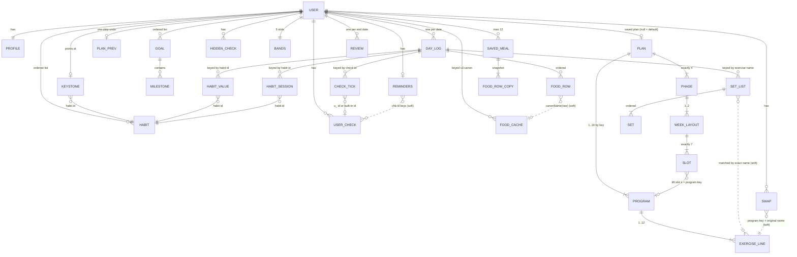

# 03. Data model

Reference for every piece of data the Recomp web app (build `2026-10-14 r14`, single file `app-r14.html`) stores, how it is stored today, and how to store it in the native app. Everything here was read from the source. Where the code is ambiguous, the text says so and the item is repeated in [Ambiguities and quirks](#13-ambiguities-and-quirks).

Machine-readable versions of the core entities are in `../schemas/*.schema.json` (JSON Schema draft 2020-12), with fictional examples in `../schemas/examples/`.

Contents

1. [Conventions](#1-conventions)
2. [How persistence works today](#2-how-persistence-works-today)
3. [Storage map](#3-storage-map)
4. [Core entities](#4-core-entities): Profile, Goal, Plan, Previous plan, Day log
5. [Habits and timers](#5-habits-and-timers): Habit, Keystone, Running timers, Pomodoro, Clock mode
6. [Checklist](#6-checklist): built-in checks, user checks, hidden checks
7. [Training extras](#7-training-extras): Bands, Exercise swaps, Workout session state
8. [Food extras](#8-food-extras): Estimate cache, Saved meals, built-in food table
9. [Claude and calendar features](#9-claude-and-calendar-features): Weekly review, Reminders
10. [Device-only UI preferences](#10-device-only-ui-preferences)
11. [Backup file](#11-backup-file)
12. [Relationships](#12-relationships)
13. [Ambiguities and quirks](#13-ambiguities-and-quirks)
14. [Derived values (computed, never stored)](#14-derived-values-computed-never-stored)
15. [Sensitive data](#15-sensitive-data)
16. [Recommended relational / cloud schema for the mobile app](#16-recommended-relational--cloud-schema-for-the-mobile-app)
17. [Migration from the web app](#17-migration-from-the-web-app)

---

## 1. Conventions

| Topic | Rule in the code |
|---|---|
| Day key | `YYYY-MM-DD` string. "Today" is the **device's local calendar date** (`localKey()`), but all date arithmetic (`d()`, `addDays`, `diffDays`, weekday) treats the key as a UTC midnight. So the key is a calendar date with no time zone attached. Keep it that way (a `date` column, not a timestamp). |
| Instants | Epoch milliseconds (`Date.now()`): `plan.at`, `review.at`, `profile.setupAt`, `reminders.at`, habit session `s`/`e`, timer `startedAt`, Pomodoro `endsAt`, workout `start`. |
| Weight | Kilograms, decimals allowed (input step 0.1). |
| Waist | Centimeters (step 0.5), measured at the navel. |
| Sleep | Hours, decimal (step 0.25). |
| Steps | Integer count. |
| Energy | kcal. Macros in grams: `p` protein, `c` carbohydrate, `f` fat, `fib` fiber. |
| Habit values | Number in the habit's own unit. Hour habits store decimal hours (1.25 = 1 h 15 min). |
| Set load | `w` kg, `b` band slot 1 to 5, `r` reps (or seconds for timed holds). |
| Generated ids | Prefix + `Date.now().toString(36)`, sometimes plus a random 0-999: goals `g...`, habits `h...`, notes `n...`, saved meals `m...`, user checks `u_...`, reminders tag `ft-...`. Not globally unique; unique per user in practice. |
| Absent vs empty | Day log fields are deleted when cleared, so "absent" means "not logged". A value of `0` is a real value. |

## 2. How persistence works today

There are two layers. Every save writes both, and the local copy is what renders first.

1. **localStorage** keys prefixed `goa:` (one browser, one device).
2. **A document database** reached through `window.claude.use("db")` with a Firestore-like API: `db.doc(path).get()/.set()`, `db.collection(name).get()/.orderBy().limit()/.onSnapshot()`. Documents live under `state/*` (one doc per settings object), `log/<YYYY-MM-DD>` (one doc per day) and `reviews/<id>`.

Helpers that matter for migration:

- **`dbSet(path, obj)`** writes `dbEnc(obj)` with a fire-and-forget `set()` (full overwrite, no merge). Errors are only logged.
- **`dbEnc`** wraps any array that sits directly inside another array as `{"__arr": [...]}`, recursively, because the database refuses nested arrays. **`dbDec`** reverses it: any object whose only key is `__arr` (with an array value) becomes that array. In practice only the plan has nested arrays (`phases[].weeks` is an array of 7-slot arrays).
- **`snapData(sn)`** deep-copies `sn.data()` (database reads arrive frozen). It does **not** decode `__arr`. The code calls `dbDec` explicitly only for `state/plan`, `state/planprev` and the latest review. Other docs are read without `dbDec`, which is safe only because they contain no nested arrays.
- **Day logs are written differently**: `persist()` calls `db.doc("log/"+k).set(e)` directly, without `dbEnc`. A restored backup writes them through `dbSet` (with `dbEnc`). Both produce the same bytes because a day log has no nested arrays.
- **Saving cadence**: typed day fields wait 700 ms (`queueSave`), are flushed on `visibilitychange: hidden` and `pagehide`, and most other edits call `persist(false)` immediately. Settings docs are written on every change.
- **Live sync**: only `log` is subscribed (`onSnapshot`, `limit(1000)`). All `state/*` docs and the latest review are read once at startup. Conflict handling is "last write wins" per whole document, with these local rules: a day being edited is never overwritten by an incoming snapshot; if the local copy of the day being edited lost its `food` array but kept `kcal`/`protein`, food is restored from the server copy; a day deleted on the server is deleted locally, unless the server never held it, in which case the local day is uploaded once.
- **Startup order**: localStorage values (profile, plan, plan prev, goals, user checks, hidden checks, timers, Pomodoro, clock mode, keystone, review, meals, workout, reminders, all `goa:<date>` keys, bands, swaps, estimate cache, habits), first render, then each db doc overwrites its local value when it exists. A db doc that exists replaces the local value entirely.

## 3. Storage map

Synced = also written to the database. Device = localStorage only.

| What | localStorage key | DB path and envelope | Synced | Writer functions | In backup |
|---|---|---|---|---|---|
| Profile | `goa:profile` | `state/profile` = the profile object itself | yes | `saveProfile` (called by `renderAbout`, `renderNotes`, `renderHistory`, `finishOnboarding`, `restoreBackup`) | `profile` |
| Goals list | `goa:goals` (array) | `state/goals` = `{list:[Goal]}` | yes | `saveGoals` | `goals` |
| Plan | `goa:plan` (Plan, or key removed) | `state/plan` = `{plan: Plan or null}` with `__arr` wrapping | yes | `persistPlan` via `savePlan` | `plan` |
| Previous plan | `goa:planprev` | `state/planprev` = `{plan, kcal, protein}` (or `{plan:null}`) with `__arr` wrapping | yes | `persistPlan` via `savePlan` | `planPrev` |
| Day log | `goa:<YYYY-MM-DD>` | `log/<YYYY-MM-DD>` = the day object | yes | `persist` (plus `collect`, `queueSave`, `flushSave`) | `entries` |
| Habits | `goa:habits` (array) | `state/habits` = `{list:[Habit]}` | yes | `saveHabits` | `habits` |
| Keystone habit | `goa:keystone` (plain string) | `state/keystone` = `{id: string}` | yes | `saveKeystone` | `keystone` |
| User checks | `goa:userchecks` (array) | `state/userchecks` = `{list:[UserCheck]}` | yes | `saveUserChecks` | `userChecks` |
| Hidden checks | `goa:hiddenchecks` (object) | `state/hiddenchecks` = `{map:{id: label or true}}` | yes | `saveHiddenChecks` | `hiddenChecks` |
| Bands | `goa:bands` (array) | `state/bands` = `{names:[Band x5]}` | yes | `saveBands` | `bands` |
| Exercise swaps | `goa:swaps` (object) | `state/swaps` = `{map:{...}}` | yes | `saveSwaps` | `swaps` |
| Estimate cache | `goa:estcache` (object) | `state/estcache` = `{map:{...}}` | yes | `saveEstCache` (from `estimate`, `rememberFood`, `logLabelFood`) | `estCache` |
| Saved meals | `goa:meals` (array) | `state/meals` = `{list:[SavedMeal]}` | yes | `saveMeals` | `savedMeals` |
| Weekly reviews | `goa:review` (latest only) | `reviews/<id>` = the review, via `dbSet` | yes | `saveReview` | `reviews` (all, read from the collection) |
| Reminders | `goa:rem` | `state/reminders` = the whole object | yes | `saveRem` | `reminders` (`items` only) |
| Running habit timers | `goa:timers` | none | device | `saveTimers` | no |
| Pomodoro | `goa:pomo` | none | device | `savePomo` | no |
| Clock mode per habit | `goa:tmode` | none | device | `clockMode` handlers | no |
| Workout session | `goa:wo` | none | device | `saveWo` | no |
| Rest timer length | `goa:rest` | none | device | `woClick` (`restlen`) | no |
| UI prefs | `goa:view`, `goa:theme`, `goa:cue`, `goa:warm`, `goa:prog`, `goa:range`, `goa:metric`, `goa:kcalrange`, `goa:kcalmetric`, `goa:calf`, `goa:nudgeoff`, `goa:acc:<panelId>:<n>` | none | device | various | no |

The day-log loader treats any `goa:` key whose suffix matches `^\d{4}-\d{2}-\d{2}$` as a day. The task brief mentions a removed `state/diag` doc; r14 has no reference to it.

---

## 4. Core entities

### 4.1 Profile

Schema: `schemas/profile.schema.json`. One object per person; everything is optional (a new user has `{}`).

Purpose: body facts used for targets, food context for Claude, personal rules, notes, earlier weigh-ins and personal foods.

| Field | Type | Units / allowed values | Default when missing | Written by | Read by |
|---|---|---|---|---|---|
| `name` | string, max 30 | first name | none | `renderAbout`, `finishOnboarding` | onboarding greeting, toast |
| `sex` | string | `female`, `male`, `""` (prefer not to say) | `""` | `renderAbout`, `finishOnboarding` | `kcalFloor`, `calcTargets` |
| `age` | number or null | years, 13 to 100 (null if outside, About form) | none | same | `planRules`, onboarding |
| `heightCm` | number or null | cm, 120 to 230 | none | same | `planRules`, `renderHistory` (BMI), `calcTargets` |
| `cuisine` | string, max 40 | free text | none | same | `askClaude`, `runPlate` prompts |
| `waterL` | number or null | liters, 1 to 6 | 3 | `renderAbout` | `checkList` (water check text) |
| `kcalFloor` | number or null | kcal, 900 to 4000 | 1200 female, 1500 male, 1400 other | `renderAbout` | `kcalFloor()` (plan edits, reviews, Claude rules) |
| `proteinFloor` | number or null | g, 30 to 300 | `round(goal.protein*0.85/5)*5` | `renderAbout` | `proteinFloor()` |
| `jointFriendly` | boolean | | false | `renderAbout`, `finishOnboarding` | `planRules` |
| `rules` | string, max 1200 | one rule per line | `""` | `renderAbout` | `planRules` (sent to Claude) |
| `equip` | string | `gym`, `home`, `body` | `gym` | `finishOnboarding` only | `makePlan` |
| `days` | integer | 2 to 5 | 3 | `finishOnboarding` only | `makePlan` |
| `setupAt` | number | epoch ms | none | `finishOnboarding` | nothing reads it |
| `waistDay` | integer 0 to 6 (or numeric string) | 0 = Sunday | 1 (Monday) | **no UI** | `waistWeekday` (waist check and input visibility) |
| `notes[]` | array of Note | see below | `[]` | `renderNotes` | `renderNotes` |
| `history[]` | array of HistoryEntry | see below | `[]` | `renderHistory` | `histW` (chart), `renderHistory` |
| `myFoods[]` | array of MyFood | see below | `[]` | **no UI** | `buildFoodIndex` |

Note: `{id: "n<base36>", group: "My notes", title (max 80, default "New note"), body (max 8000)}`. Body is plain text; a line starting with `- ` is a bullet and a blank line starts a paragraph.

HistoryEntry: `{d: date, kg: number (20 < kg < 400), note: string max 40}`. Adding a date replaces an existing entry for the same date.

MyFood (same shape as the built-in table): `{n: name, k: [keywords], per: "unit" or "100g", g: grams of one unit or default serving, v: [kcal, p, c, f, fib]}`. Invalid entries are skipped silently.

### 4.2 Goal

Schema: `schemas/goal.schema.json`. Stored as an **ordered list**; the active goal is the last one with `done:false` (`activeGoal`). With no stored goals, a provisional goal (`id:"g0"`, `provisional:true`, never saved) keeps the screens working until setup.

| Field | Type | Allowed / units | Default | Notes |
|---|---|---|---|---|
| `id` | string | `g<base36>` | | required |
| `provisional` | boolean | | | in-memory only; `saveGoals` deletes it |
| `name` | string, max 40 | | onboarding: Lean out / Recomp / Build muscle / Feel better | |
| `why` | string, max 160 | | `""` | personal |
| `type` | string | `lose`, `recomp`, `muscle`, `health` (written); `gain`, `maintain` (only read) | treated as `lose` when missing | affects maintenance week and review rules |
| `start` | date | | today at setup | weight timeline start |
| `due` | date | after `start` | start + weeks*7 - 1 | last plan day |
| `event` | date or null | on or up to 30 days after `due` | null | countdown target ("the day itself") |
| `trainStart` | date | | falls back to `start` | training schedule start |
| `startKg` | number or null | kg | first logged weight on or after `start` | |
| `targetKg` | number or null | kg | equals start weight | |
| `endKg` | number or null | kg | | set when finished |
| `kcal` | number | kcal/day | 2200 (code fallback) | also edited from the plan screen and reviews |
| `protein` | number | g/day | 180 in `plan()` and `gSave`, 120 in `checkList` and table colors | inconsistent fallbacks |
| `steps` | number | steps/day | 8000 | base for default plan phase steps |
| `homeFirst` | boolean | | false | selects `homeFirstPlan` |
| `done` | boolean | | false | |
| `milestones[]` | array | `{d: date, k: "lab" or "task", t: string max 120}` | `[]` | bloods (`lab`) are medical |

Writers: `saveGoals` is called by `gSave` (edit form), `msAdd` and milestone delete in `renderGoal`, `gNext` (finish and start the next goal), `finishOnboarding`, target edits in `renderPlanView`, `restorePrevPlan`, `acceptProposal`, `applyReviewChange`, `restoreBackup`.

Readers: `applyGoal` turns the active goal into the globals `START`, `END`, `DEPART` (event or due), `START_KG`, `TARGET_KG`, `TSTART`, phase bounds, `LABS`, `TASKS`, `PROJ`. Almost every renderer reads those globals.

### 4.3 Plan

Schema: `schemas/plan.schema.json`. One object (or nothing). **No stored plan means the default protocol**, rebuilt on every load from the active goal and profile by `defaultPlan()` (`makePlan()` normally, `homeFirstPlan()` when `goal.homeFirst`). This matters: changing the profile or goal changes the default plan retroactively, while a saved plan is frozen.

```
Plan {
  v: 1,
  by: "default" | "claude" | "you",
  at: epoch ms | null,
  note: string (max 140),
  programs: { <key>: { name (max 40), kit: "gym"|"home"|"body", ex: ["name|scheme|cue", ...] (1..12) } } (1..16),
  phases: [ exactly 4 x { name (max 40), detail (max 700), steps (2000..30000), weeks: [ 1..2 x [ exactly 7 slots ] ] } ],
  targets: { carb 50..500 (200), fat 20..200 (65), fiber 10..80 (33) }
}
slot = {t:"lift", s:<program key>, c} | {t:"cardio", c} | {t:"rest", c}   (c max 220)
```

Every plan from storage, a backup or Claude goes through **`normPlan`**, which clamps the limits above, rewrites `3x10` to `3 × 10`, drops exercise lines without a digit in the scheme, turns a lift slot pointing at an unknown program into cardio, fills empty slot text (`"Rest day."`, `"Walk at an easy pace."`) and refuses (returns null) anything without four phases of seven-day weeks. Rebuild this validator on the server or in a shared package.

- Program keys: any `[A-Za-z0-9_-]{1,24}`. Defaults: `homeA, homeB, bodyA, bodyB, fullA, fullB, lowerA, upperA, lowerB, upperB`.
- Exercise line: `name|scheme|cue`. The scheme's leading number is the planned set count (`setCount`, default 3). A scheme whose reps part contains `s` or `sec` is a timed hold. **Logged sets are matched to exercises by exact name** (see Day log), so the exercise name is a join key.
- Week slots: index 0 is the weekday of `goal.trainStart`, not Monday. Odd plan weeks use `weeks[0]`, even weeks `weeks[1]` when present.
- Phase lengths are not stored. `phaseBounds(weeks)` splits the training weeks (see section 14).
- Calories and protein are **not** in the plan; they are goal fields. Macro targets (carb, fat, fiber) are in the plan.

Writers: `savePlan(np, prevGoal)` (from `renderPlanView` target edits and session edits, "Back to the original", `restorePrevPlan`, `acceptProposal`, `applyReviewChange`), `gSave` (shifts every phase's steps when the goal steps change), `finishOnboarding` (resets to default), `restoreBackup`. Readers: `applyPlan` builds `PL`, `LIFTS`, `NAMES`, `PHASES`; then `plan(k)`, `renderPlanView`, `renderReference`, `remRows`, `remEvents`, `planDiff`, `compactPlan`.

### 4.4 Previous plan

`{plan: Plan or null, kcal: number or null, protein: number or null}`. Written by `savePlan` every time the plan changes: the plan being replaced plus the goal's calorie and protein targets at that moment. Read by `restorePrevPlan` (one-tap undo) and to show the "Restore previous plan" button. Only one level of history. When nothing has been replaced yet, the db doc is `{plan:null}` and localStorage holds `null`. It is **not** passed through `normPlan` on load, only on restore.

### 4.5 Day log

Schema: `schemas/day-log.schema.json` (food row, set, legacy set and habit session are in `$defs`). One document per calendar date; the date is the document id, not a field. Every field is optional.

| Field | Type | Units | Written by | Notes |
|---|---|---|---|---|
| `w` | number | kg | `collect` (inputs `fW`, `qW`), `finishOnboarding` (setup day, if empty) | |
| `steps` | number | count | `collect` (`fS`, `qS`), `setDaySteps` (walk habit wheels) | |
| `sleep` | number | hours | `collect` (`fSl`, `qSl`) | |
| `waist` | number | cm | `collect` (`fWa`, `qWa`) | input shown only on the waist weekday |
| `note` | string | | `fNote` change handler | session note, Train tab |
| `kcal` | integer | kcal | `syncFoodToDay`, `collect`, sync repair | **derived** from `food` when food exists; deleted when the last food row goes. A day without food may carry a legacy or restored value; no r14 UI types one |
| `protein` | integer | g | same | derived like `kcal` |
| `food[]` | array of FoodRow | | `addFood`, `bulkAsk`, row edit in `renderFood`, `logLabelFood`, `addMealRows` (saved, recent and plate-photo meals), Undo | order matters |
| `sets{}` | map exercise name to Set[] | | `writeSet` (set grid and Workout mode) | |
| `habits{}` | map habit id to number | habit unit | `setHabitValCore`, `stopTimer`, `logFocus`, session delete | |
| `hlog{}` | map habit id to Session[] | | `addSegs` (via `stopTimer`, `logFocus`, Undo), session delete, `resetHabitToday` | |
| `checks{}` | map check id to boolean | | checklist change handler (writes true **and false**), Workout mode "Save and close" (`train: true`), hero quick tick | |

**FoodRow** `{label, raw, kcal, p, c, f, fib, meal, src}`

- `label`: display text, usually `Name (amount)`. Suffixes the code adds inside the brackets: ` · assumed serving` (table row with no amount), `, from photo` (plate photo), a U+2014 em dash followed by ` from label` (nutrition label).
- `raw`: what was typed for that item. The estimate cache key is derived from it. Plate-photo rows use `"<name> <g> g"`. Can be missing on legacy rows.
- `kcal, p, c, f, fib`: totals for the portion, not per 100 g. Not rounded for table and label rows.
- `meal`: integer from 1. Each "Add" (text box, saved meal, recent meal, plate photo, label) takes `max(meal)+1`. Rows without `meal` are legacy and render ungrouped.
- `src`: `table` (built-in or personal food table), `claude` (text estimate or plate photo), `you` (typed or corrected; also the default for saved-meal rows lacking a src), `label` (photo scan or manual per-100 g form), `none` (no numbers yet), `pending` (estimate in flight). The brief's list omits `label`; it exists (`logLabelFood`). `pending` is transient: `renderFood` resets it to `none` whenever no request is running, so a stored `pending` means `none`. A row "needs numbers" when `src` is `none`, or when `src` is `claude` or unknown and both `kcal` and `p` are zero.

**Set** `{w?, r?, b?}`: `w` kg, `r` reps or seconds, `b` band slot 1 to 5. Load kind is decided from the exercise name (`loadKind`: names containing "band" are band, a fixed regex list is bodyweight, everything else is weight). Workout mode refuses a set without reps, but the set grid allows any field alone. Empty trailing sets are trimmed; the exercise key is deleted when no set remains.

- **Key**: the exercise's display name that day, i.e. after any swap (`resolveLine(...).name`). History, "last time", progression and volume all look sets up by that exact name, across all sessions.
- **Legacy shape**: one object `{w, r}` instead of an array. `setsFor()` reads it as `[{w, r}]`. Never written by r14.

**Session** `{s, e}` epoch ms, `e > s`, sorted by `s`. The `habits[id]` value remains the day's amount; the difference between it and the summed sessions shows as "Entered by hand".

**Check ids**: built-in `waist`, `photos`, `water`, `protein`, `lab`, `task`, `mobility`, `train`, `sleep`; user checks `u_...`. `checks.train = true` counts the day as trained even with no sets.

---

## 5. Habits and timers

### 5.1 Habit

Schema: `schemas/habit.schema.json`. Ordered list (display order, changed by Move up/Down).

| Field | Type | Allowed | Default | Notes |
|---|---|---|---|---|
| `id` | string | `gaming`, `walk` (seed), `h...`, `focus...` | | required, stable, referenced by day logs, keystone, timers, Pomodoro, reminders |
| `name` | string, 1 to 40 | | | |
| `type` | string | `build` (value >= goal), `limit` (value <= goal) | `build` | |
| `unit` | string, max 8 | `min`, `h` (both timed), `times`, `steps`, `glasses`, `L`, `pages`, `km`, `g`, or custom | | `normUnit` folds spellings of hours and minutes |
| `goal` | number >= 0 | in unit | | target or cap |
| `step` | number > 0 | | 1 (by unit: min 5, h 0.5, steps 500, L 0.5, pages 5, km 0.5, g 10) | stepper increment |

Seed when nothing is stored: `{id:"gaming", name:"Gaming / media", type:"limit", unit:"h", goal:2, step:0.5}` and `{id:"walk", name:"Walk", type:"build", unit:"min", goal:10, step:5}`. A build habit whose id is `walk` or whose name matches `steps`/`walk` also shows and edits the day's `steps` (`tracksSteps`).

Writers: `saveHabits` from `renderHabitForm` (add), goal steppers, delete with undo, reorder, `ensureFocusHabit`, `finishOnboarding`, `restoreBackup`. Deleting a habit does **not** delete its values in day logs; they become orphaned but are kept.

### 5.2 Keystone habit

A single habit id: localStorage `goa:keystone` (raw string, `""` for none), db `state/keystone` as `{id}`. When the id does not match a habit, `getKeystone()` falls back to the first build habit, then the first habit. Cleared when that habit is deleted.

### 5.3 Running habit timers (device only)

`goa:timers` = `{ <habitId>: { running: bool, startedAt: ms, accumMs: ms, day: "YYYY-MM-DD", segs: [{s,e}] } }`. Only one runs at a time (starting one pauses others). `day` is the day on screen when started; on Stop, the elapsed time is added to that day (`habits[id]`, rounded to 2 decimals for hours, 0 for minutes) and the segments go to that day's `hlog`. Timers missing `day` (older versions) are assigned the local date of `startedAt`. Not synced: a timer started on one device is invisible on another.

### 5.4 Pomodoro (device only)

`goa:pomo` = `{phase: "idle"|"work"|"break", running: bool, endsAt: ms, remainMs: ms, workMin: 1..120 (25), breakMin: 1..60 (5), targetId: habit id or null, cycles: integer}`. Each finished or stopped work block calls `logFocus`, adding minutes to the target build habit (hours habits get `min/60`) and a session to `hlog`. With no `targetId`, the first timed build habit whose name matches `focus|work|study|read|deep|learn|write|code` is used. `cycles` is labelled "blocks today" but is never reset (see Ambiguities).

### 5.5 Clock mode (device only)

`goa:tmode` = `{ <habitId>: "up" | "down" }`. Whether the running timer shows session time or time left.

---

## 6. Checklist

The day's checklist is **computed** by `checkList(plan(k))` (section 14); only ticks (`day.checks`) and the user's edits are stored.

Built-in items: `waist` (on the waist weekday), `photos` (last slot of every 4th plan week), `water`, `protein`, `lab` and `task` (milestone days), `mobility`, `train` (lift or cardio days), `sleep`. The list is sorted by the `w` ("when") label using a fixed rank table (`waking`, `morning`, `breakfast`, `all day`, `meals`, `daytime`, `lunch`, `afternoon`, `session`, `after`, `anytime`, `evening`, `dinner`, `bedtime`, `night`; unknown labels rank as `anytime`).

### 6.1 User checks

localStorage `goa:userchecks`, db `state/userchecks` as `{list:[...]}`.

`UserCheck {id: string, t: string (max 60), w: string (max 12, "when"), s: string (subtitle), builtinOnly?: boolean}`

- A user check whose `id` equals a built-in id **overrides** that item's `t`, `w` and `s` (rewording) instead of adding a row.
- A new user check gets `id: "u_" + base36 time + random 0-999` and `s: ""`.
- `builtinOnly` is read (an override that must not add a row when the built-in is absent that day) but nothing in r14 writes it.
- This is where people put **medicines and supplements** ("Vitamin D", a prescription), so treat it as health data.

### 6.2 Hidden checks

localStorage `goa:hiddenchecks`, db `state/hiddenchecks` as `{map:{...}}`. `{ <checkId>: <label string> | true }`. The label (the item's text at the time it was hidden) is only used to show the item in the "Hidden" list; `true` is accepted and shows the id. Hiding applies to every day.

---

## 7. Training extras

### 7.1 Bands

localStorage `goa:bands`, db `state/bands` as `{names:[...]}`. Exactly 5 slots, lightest first: `[{n: string (max 16), kg: number or null}]`. Default names `Band 1` to `Band 5`, `kg` null. `normBands` also accepts the legacy array of 5 plain strings (kg becomes null) and rejects any length other than 5. Sets store the slot number (`b`), so renaming a band relabels history; `kg` is used for volume (`bandKg`).

### 7.2 Exercise swaps

localStorage `goa:swaps`, db `state/swaps` as `{map:{...}}`. `{ "<programKey>|<original exercise name>": "<alternate exercise name>" }`. The alternate must exist in the built-in alternates pool (`ALTPOOL`) for that exercise's muscle group (`EXGROUP`) and kit context (home or gym), otherwise `resolveLine` ignores it. The swap keeps the session's rep scheme and replaces name and cue. Because sets are keyed by display name, a swapped exercise builds its own history.

### 7.3 Workout session state (device only)

`goa:wo` = `{day: date, session: program key, start: ms, idx: integer (current exercise, may equal the exercise count to show the summary), done?: true}`. Restored only when `day` matches today and `session` matches the planned session and it is not `done`. Rest timer length: `goa:rest` = seconds, 30 to 300 (default 90). Rest end time is in memory only.

---

## 8. Food extras

### 8.1 Estimate cache

Schema: `schemas/food-cache-entry.schema.json`. localStorage `goa:estcache`, db `state/estcache` as `{map:{ <key>: Entry }}`.

- **Key**: `"v2:" + canonName(description)`. `canonName` lowercases; removes numbers with units (kg, g, ml, l, katori, cups, tbsp, pieces, slices, bowls, plates and more); removes a trailing `from <place>`; removes digits and punctuation; drops neutral words (`boneless`, `cooked`, `homemade`, `plain`, `fresh`, `large`, `small`, `medium`, `serving`, articles and others); sorts the remaining words; joins with single spaces. Example: `"200 g grilled chicken tikka"` and `"chicken tikka grilled 200g"` both give `v2:chicken grilled tikka`.
- **Entry**: `{name, serving_g (default 100), per100: {kcal, p, c, f, fib}, by?: "you", unitOnly?: true}`.
- **Writers**: `estimate()` stores Claude's per-100 g answer (no `by`); `rememberFood()` stores a person's corrected row scaled to per 100 g (`by:"you"`; with no weight in the text it stores **one piece** under `per100` with `serving_g:100` and `unitOnly:true`); `logLabelFood()` stores a nutrition label (`by:"you"`, `serving_g` = grams eaten).
- **Reader**: `estimate()` returns a cached entry, scaled by `portionOf` (grams in the text, or count x `serving_g`, or one serving), before calling Claude. Dish descriptions with listed ingredients (`isDish`) are never cached or looked up.
- The comment at load says "shared estimates, so a food is priced once". In r14 the doc is in the same db as everything else; whether that db is per user or shared across users is decided by the host, not this code. For the native app, see section 16 on splitting a global cache from per-user overrides.

### 8.2 Saved meals

Schema: `schemas/saved-meal.schema.json`. localStorage `goa:meals`, db `state/meals` as `{list:[...]}`. `{id: "m...", name (max 30), sig: string, rows: [{label, kcal, p, c, f, fib, src, raw}]}`, newest first, at most 12. Created from a meal's "Save meal" button in `renderMealSave` (rows that are pending or have no numbers are left out); removed in `renderFoodQuick`. Logging copies the rows into today's food log as a new meal (`addMealRows`). `sig` is derivable (short labels joined by ` + `).

"Recent meals" (the one-tap list) are **derived** from the last 21 days of day logs (`recentMeals`), grouped by `sig`.

### 8.3 Built-in reference data (static, in code)

Not user data, but the native app needs it as bundled content or a reference table:

- `FOODS`: about 80 foods `{n, k[], per: "unit"|"100g", g, v:[kcal,p,c,f,fib]}` used by `matchFood` (longest keyword wins, leftover words that are not preparation words send the item to Claude).
- `LIFTS_DEFAULT` and `NAMES_DEFAULT`: the 10 default programs and their exercise lines.
- `EXGROUP` (exercise name to muscle-group slot) and `ALTPOOL` (alternates per slot, `"Name|cue|muscles"`, split into home and gym pools).
- `MOB_PRE`, `MOB_POST` (warm-up and stretch lists), `FLOORS`, `LINES` (quotes), `HABIT_OPTS` (onboarding habit choices), `HABIT_UNITS`.

---

## 9. Claude and calendar features

### 9.1 Weekly review

Schema: `schemas/review.schema.json`. db collection `reviews`, doc id = `id`; localStorage `goa:review` keeps only the latest.

`{id: date (end of week), at: ms, from: date, to: date, stats: WeekStats, out: {headline, wins[<=3], watch[<=3], focus, suggestion: {what, why, change: {kcal} | {steps} | null}}, applied: bool}`

- Created by `runReview` and bounds-checked by `normReview` (a kcal change must be within 250 kcal of the current target, in the allowed direction for the goal type, not under the floor, and needs at least 5 food days; a steps change is rounded to 100 and may raise steps by at most 2500).
- `stats` is a snapshot from `weekStats()` (averages, counts, habit hit rates, strength comparisons). It is denormalized on purpose: the review must read the same after logs change.
- `applyReviewChange` sets the goal's `kcal`, or raises the steps of the current and later phases of a saved plan (or the goal's `steps` when on the default plan), then sets `applied: true`.
- Due again 7 days after `to` (`reviewDue`). Running twice on the same day overwrites the doc.

### 9.2 Reminders

Schema: `schemas/reminders.schema.json`. localStorage `goa:rem`, db `state/reminders` (whole object).

`{items: { <key>: {on: bool, time: "HH:MM"} }, events: [{k, id or null, title}], tag: "ft-..." or null, at: ms or null}`

- Item keys: `train` (default 18:30, on), `chk:<checkId>` for daily checks except waist, photos, lab, task, mobility, train, protein, water (default time from the "when" label, off), `dates` (milestones; fixed alerts at 08:00 on the day and 18:00 the day before; default on), `review` (default 19:00 on, on the plan week's last weekday). Items are created lazily by `remItem` the first time a row is drawn.
- `events` lists Google Calendar events created through the MCP connector (`create_event`), with recurrence rules computed from the plan. `remRemoveAll` deletes them by id, or finds them by `tag` when an id was not returned.
- For the native app, the `items` map is the user preference to keep. The `events` list only matters for cleaning up calendar events made by the web app (see migration).

---

## 10. Device-only UI preferences

Keep these on the device (AsyncStorage or similar); they never need the server.

| Key | Values | Meaning |
|---|---|---|
| `goa:view` | `home`, `food`, `workout`, `progress`, `habits`, `me` | last tab |
| `goa:theme` | `auto`, `light`, `dark` | theme |
| `goa:cue` | `"1"` / `"0"` | show exercise form cues |
| `goa:warm` | `"1"` / `"0"` | show warm-up and stretch blocks |
| `goa:prog` | exercise name | exercise picked on the progression chart |
| `goa:range` | `1w`, `1m`, `3m`, `all` | weight chart range |
| `goa:metric` | `weight`, `waist` | weight chart metric |
| `goa:kcalrange` | `1w`, `1m`, `3m`, `all` | nutrition chart range |
| `goa:kcalmetric` | `kcal`, `protein`, `carb`, `fat`, `fiber` | nutrition chart metric |
| `goa:calf` | `overall`, `workout`, `food`, or a habit id | consistency calendar filter |
| `goa:nudgeoff` | date | "Not today" on the missed-session nudge |
| `goa:acc:<panelId>:<n>` | `"1"` / `"0"` | accordion section open state |
| `goa:rest`, `goa:tmode`, `goa:timers`, `goa:pomo`, `goa:wo` | see sections 5 and 7 | live session state |

## 11. Backup file

`exportFile("json")` writes `recomp-backup-<date>.json`:

```
{ app: "recomp", version: 1, exportedAt: ISO string,
  goals, plan, planPrev, habits, keystone, userChecks, hiddenChecks, bands, swaps,
  savedMeals, estCache, reminders: {items}, profile, reviews: [...], entries: { "<date>": DayLog } }
```

`restoreBackup` accepts `app` of `"recomp"` or `"fitness-tracker"` (an older name) and requires an `entries` object. It replaces every settings object that is present and valid, replaces days in the backup, and keeps days not in the backup. This file is the natural input for the native app's importer (section 17). CSV exports (daily, food, sets) are one-way and not covered here.

---

## 12. Relationships



Dotted lines are soft references: string matches with no integrity. Today none of the references are enforced. Deleting a habit, check or program leaves the day data in place.

---

## 13. Ambiguities and quirks

1. **`goal.type` values.** Written: `lose`, `recomp`, `muscle`, `health`. Read but never written: `gain`, `maintain` (only in the "Next goal" target calculation). Missing type is treated as `lose`. `recomp` and `health` get no maintenance week and use the fat-loss review rules.
2. **Protein fallback differs**: 180 in `plan()` and `gSave`, 120 in `checkList`, `provisionalGoal` and the log table colors. Store an explicit value.
3. **`kcal` / `protein` on days without food.** No r14 UI writes them, but readers accept them (charts, review stats, "food logged" state). They can come from older versions or backups. Keep them as optional manual totals.
4. **`src: "pending"`** may be persisted if the app closes mid-estimate; it means `none`.
5. **Checks store `false`** for unticked items rather than removing the key.
6. **`builtinOnly`** on user checks is read, never written.
7. **`profile.waistDay` and `profile.myFoods`** have no editor in r14; they can only come from a backup or a direct db edit.
8. **`setupAt`** is written, never read.
9. **Pomodoro `cycles`** is shown as "blocks today" but never resets at midnight.
10. **Goal created by "Next goal"** has no `trainStart` (falls back to `start`). The default 12-week length there is 84 days (start + 83).
11. **Estimate cache key can be `"v2:"`** when every word is stripped (for example a description that is only a number and a unit); `estimate()` does not guard against it, `rememberFood()` does.
12. **Estimate cache scope.** The code comment calls it shared, but whether the db is per user or shared is outside this file.
13. **Sets keyed by display name**, not by an exercise id. Renaming an exercise in the plan editor starts a new history (the UI warns about this). Two programs that share an exercise name share its history.
14. **Swaps are keyed by `programKey|originalName`.** If the plan editor renames the original, the swap silently stops applying.
15. **Week slot 0 is the training start's weekday**, so "Monday" is not fixed. Calendar weeks (strip, consistency grid) use Monday to Sunday, while plan weeks use `trainStart`.
16. **Plan-week day count vs goal days.** Weight projection and statistics run from `goal.start`; the schedule runs from `goal.trainStart`. Many loops in the code (habit streaks, `lastFor`, `exSeries`) only scan dates between `goal.start` and `goal.due`, so data outside the active goal's window is stored but invisible.
17. **`planPrev` is not normalized on load**, only on restore. A malformed stored `planPrev.plan` is silently replaced by the default plan when restored.
18. **Food row `label` encodes the amount** (`(150 g)`, `(2 × 43 g)`), and `fqQty` parses it back for display. There is no separate grams field. The native app should add one (section 16) and keep `label` for display.
19. **Timezone.** Day keys use the device's local date; timer and session instants are absolute. A habit timer started before midnight is credited to its start day.
20. **Last write wins per document.** Two devices editing the same day or the same settings doc overwrite each other's whole document.

---

## 14. Derived values (computed, never stored)

Brief list; full formulas belong in `05-business-logic.md`.

| Value | Function | Inputs |
|---|---|---|
| Active goal and timeline globals (`START`, `END`, `DEPART`, `TOTAL`, `WEEKS_N`, `START_KG`, `TARGET_KG`, `TSTART`, `TTOTAL`, `TWEEKS`) | `activeGoal`, `applyGoal` | goals, day logs (fallback start weight) |
| Phase week ranges | `phaseBounds(weeks)`: splits at about 23.5%, 58.8%, 88.2% of the weeks | training weeks |
| Maintenance week (`TMAINT_W`) | last week of phase 2 minus one | phase bounds |
| Weight projection line (`PROJ`, `projFor`) | `buildProj`: first two weeks weigh 1.9x, maintenance week 0 | start and target kg, weeks |
| Day schedule `plan(k)` | `{idx, inRange, week, dow, phase, lab, task, waistDay, kcal (goal kcal, +500 in the maintenance week for lose goals), protein, steps (phase steps), type: lift/cardio/rest/off, session, cardio}` | goal, plan, profile.waistDay |
| Default plan | `defaultPlan`, `makePlan`, `homeFirstPlan` | goal kcal, protein, steps, homeFirst; profile equip, days |
| Day checklist | `checkList(plan(k))` | built-ins, user checks, hidden checks, profile.waterL |
| Day food totals | `foodTotals(k)`; carbs, fat and fiber are summed from rows on demand (`dayNutrient`) | food rows |
| Calorie and protein floors | `kcalFloor`, `proteinFloor` | profile, goal |
| Onboarding targets | `calcTargets`: Mifflin-St Jeor BMR, activity factor from steps and days, goal-type adjustment, protein from a reference weight | onboarding answers |
| 7-day rolling weight average | `rolling` | day logs |
| Rate of loss | `rateOfLoss`: least squares over the last 28 days, needs 4 points over 9+ days | day logs |
| Session state per day | `dayState`, `cellState`, `trainedOn`, `itemState`, `dayScore`, `dotState` | plan(k), day logs, habits |
| Session streaks | `streaks` (rest days do not break) | dayState |
| Habit stats | `habitStreak`, `habitLongest`, `habitStrength` (EMA, alpha 0.22, start 50), `habitPct`, `habitsHitPct`, `dayMet` | habit values |
| Load volume | `volumeOf`, `exVolume` (kg x reps; bands use band kg; bodyweight and timed sets excluded) | sets, bands |
| "Last time", suggested load, personal bests | `lastFor`, `woSuggest`, `bestBefore`, `bestToday`, `lastSameSession` | sets |
| Missed-session nudge | `missStats`, `dayActive` | day logs |
| Week stats for Claude | `weekStats` | everything for 7 days |
| Recent meals | `recentMeals`, `mealsOf` | last 21 days of food rows |
| Resolved exercise (swap applied) | `resolveLine` | plan, swaps, `EXGROUP`, `ALTPOOL` |
| Reminder events | `remRows`, `remEvents` | plan, goal, checklist, reminder items |

Recommendation: compute these in a shared domain module (TypeScript) used by both the app and any server job. Do not store them, except the deliberate snapshots (`review.stats`, `day_logs.kcal/protein` as a cache, see below).

---

## 15. Sensitive data

Treat the whole account as health data (personal data concerning health under GDPR, and consumer health data under laws such as Washington's My Health My Data Act). In particular:

| Data | Where | Why sensitive |
|---|---|---|
| Weight, waist, sleep, steps | day log `w`, `waist`, `sleep`, `steps`; `profile.history` | body measurements |
| Age, sex, height | profile | identifying and health-related |
| Medicines, supplements | user checks (`t`, `s`), check ticks, reminders `chk:` items, calendar event titles | medication adherence |
| Blood tests | goal milestones with `k:"lab"` | medical appointments |
| Free text | `profile.rules` (injuries), `profile.notes` (doctor advice), day `note`, goal `why`, food `raw` | anything can be in there |
| Food log, habits | day log | diet and behavior (for example a limit habit on alcohol or gaming) |
| Photos | label and plate photos are sent to Claude and **not stored** by r14 | if the native app keeps them, they are sensitive too |

Requirements for the native app: per-user ownership on every row, encryption in transit and at rest, no health data in analytics events, logs or push notification text by default (a reminder titled with a medicine name shows on the lock screen), account deletion that removes every row, and an export equivalent to the backup file. Data sent to Claude (profile rules, week stats, food descriptions, photos) should be disclosed in the privacy notice.

---

## 16. Recommended relational / cloud schema for the mobile app

The proposal below is relational (Postgres, for example Supabase) with row-level security; the same split works for Firestore (`users/{uid}/...` subcollections). Principles:

- Every user-owned table has `user_id uuid not null references users(id) on delete cascade`, plus `created_at`, `updated_at` (server-set) and `deleted_at` (soft delete for sync).
- Keep client-generated ids as text so migrated ids (`g...`, `h...`, `u_...`) survive and the app can create rows offline. New rows use UUIDs.
- Replace "map keyed by free text" with rows. Replace "whole document overwrite" with row-level upserts so two devices editing different things do not clobber each other.
- Keep day-level summary values (`kcal`, `protein`) as cached columns that are recomputed from food rows when present.

### 16.1 Tables

**users** (auth): `id uuid pk`, `email`, `created_at`. Managed by the auth provider.

**profiles** (1:1 with users)

| Column | Type | Notes |
|---|---|---|
| `user_id` | uuid pk, fk users | |
| `name` | text | |
| `sex` | text check in (`female`,`male`,`unspecified`) | map `""` to `unspecified` |
| `birth_year` or `age` | int | consider storing birth year; r14 stores age |
| `height_cm` | numeric(5,1) | |
| `cuisine` | text | |
| `water_l` | numeric(3,2) | |
| `kcal_floor`, `protein_floor` | int null | null means formula default |
| `joint_friendly` | bool default false | |
| `rules` | text | sensitive |
| `equipment` | text check in (`gym`,`home`,`body`) | |
| `training_days` | smallint check 2..5 | |
| `waist_weekday` | smallint check 0..6 default 1 | |
| `setup_at` | timestamptz | |
| `keystone_habit_id` | text null, fk habits(user_id,id) | replaces `state/keystone` |
| `bands` | jsonb | 5 `{name, kg}` slots, or a `bands` table `(user_id, slot 1..5, name, kg)` |

**profile_notes**: `id text pk`, `user_id`, `group_name`, `title`, `body`, `sort`. Index `(user_id)`.

**weight_history** (pre-tracking weigh-ins): `user_id`, `date`, `kg`, `note`; pk `(user_id, date)`. Alternatively fold into `day_logs` with a `source='history'` flag; kept separate here to match r14 behavior (shown only as a faded line).

**personal_foods** (`myFoods`): `id`, `user_id`, `name`, `keywords text[]`, `per` (`unit`,`100g`), `grams`, `kcal`, `protein`, `carbs`, `fat`, `fiber`.

**goals**

| Column | Type | Notes |
|---|---|---|
| `id` | text pk | |
| `user_id` | uuid | |
| `name`, `why` | text | |
| `type` | text check in (`lose`,`recomp`,`muscle`,`health`,`gain`,`maintain`) | |
| `start_date`, `due_date` | date | check `due_date > start_date` |
| `event_date`, `train_start_date` | date null | train start defaults to start |
| `start_kg`, `target_kg`, `end_kg` | numeric(5,2) null | |
| `kcal`, `protein_g`, `steps` | int | |
| `home_first` | bool | |
| `status` | text check in (`active`,`done`) | replaces `done`; enforce at most one active goal with a partial unique index `(user_id) where status='active'` |
| `sort` | int | preserves list order |

Indexes: `(user_id, status)`, `(user_id, start_date)`.

**goal_milestones**: `id uuid pk`, `goal_id fk`, `user_id`, `date`, `kind` (`task`,`lab`), `text`. Index `(user_id, date)`.

**plans** (versioned instead of "plan + planPrev")

| Column | Type | Notes |
|---|---|---|
| `id` | uuid pk | |
| `user_id` | uuid | |
| `goal_id` | text null fk goals | which goal it was made for (r14 does not track this) |
| `version` | int | increments per user |
| `source` | text check in (`default`,`claude`,`you`) | `by` |
| `note` | text | |
| `targets_carb_g`, `targets_fat_g`, `targets_fiber_g` | int | |
| `kcal_at_save`, `protein_at_save` | int null | what `planPrev` kept, so restore can put them back |
| `is_current` | bool | partial unique index `(user_id) where is_current` |
| `created_at` | timestamptz | `at` |

No current plan row means "use the default protocol", as today. Restore previous = mark the prior version current.

**plan_phases**: `plan_id fk`, `phase_no` 1..4, `name`, `detail`, `steps`; pk `(plan_id, phase_no)`.

**plan_slots** (normalizes the `[[7],[7]]` arrays, removing the `__arr` problem): `plan_id`, `phase_no`, `week_variant` (1 = odd weeks, 2 = even weeks), `day_index` 0..6, `type` (`lift`,`cardio`,`rest`), `program_key` null, `note`; pk `(plan_id, phase_no, week_variant, day_index)`; fk `(plan_id, program_key)` to programs.

**programs**: `plan_id`, `key`, `name`, `kit` (`gym`,`home`,`body`); pk `(plan_id, key)`.

**program_exercises**: `plan_id`, `program_key`, `position`, `exercise_name`, `scheme`, `cue`, plus parsed `planned_sets`, `rep_low`, `rep_high`, `is_timed`; pk `(plan_id, program_key, position)`.

**exercises** (optional catalog, recommended): `id`, `name` unique, `muscle_group` (`EXGROUP` slot), `kit_context` (`home`,`gym`), `load_kind` (`weight`,`band`,`body`), `cue`, `muscles`. Seed from `LIFTS_DEFAULT`, `EXGROUP`, `ALTPOOL`. Global, read-only for users. `program_exercises` and `set_entries` can then carry `exercise_id` in addition to the name, which fixes the rename problem without losing name-based history from the web app.

**exercise_swaps**: `user_id`, `program_key`, `original_name`, `alternate_name`; pk `(user_id, program_key, original_name)`.

**day_logs**

| Column | Type | Notes |
|---|---|---|
| `user_id` | uuid | |
| `date` | date | pk `(user_id, date)` |
| `weight_kg` | numeric(5,2) null | |
| `steps` | int null | |
| `sleep_h` | numeric(4,2) null | |
| `waist_cm` | numeric(5,1) null | |
| `note` | text null | sensitive |
| `kcal_total`, `protein_total_g` | int null | cache of food totals, or manual totals on days without food rows |
| `updated_at` | timestamptz | for sync |

Indexes: pk covers range scans `(user_id, date)`.

**food_entries**

| Column | Type | Notes |
|---|---|---|
| `id` | uuid pk | |
| `user_id`, `date` | | fk to day_logs |
| `position` | int | preserves order |
| `meal_no` | int null | null for legacy ungrouped rows |
| `label` | text | display |
| `raw_text` | text null | what was typed |
| `grams` | numeric null | new; parse from label/raw during migration when possible |
| `kcal`, `protein_g`, `carbs_g`, `fat_g`, `fiber_g` | numeric | portion totals |
| `source` | text check in (`table`,`claude`,`you`,`label`,`none`) | map `pending` to `none` |
| `cache_key` | text null | `v2:...` link to the food cache |

Index `(user_id, date)`.

**set_entries**

| Column | Type | Notes |
|---|---|---|
| `id` | uuid pk | |
| `user_id`, `date` | | |
| `exercise_name` | text | the r14 join key (display name after swap) |
| `exercise_id` | text null | when the catalog is used |
| `program_key` | text null | session planned that day, if known |
| `set_no` | int | 1-based order |
| `weight_kg` | numeric null | |
| `band_slot` | smallint null check 1..5 | |
| `reps` | numeric null | reps or seconds |
| `is_timed` | bool | from the scheme |

Indexes `(user_id, date)`, `(user_id, exercise_name, date)` for "last time" and progression.

**habits**: `id text`, `user_id`, `name`, `type` (`build`,`limit`), `unit`, `goal`, `step`, `sort`, `archived_at` (instead of hard delete, so history keeps a name); pk `(user_id, id)`.

**habit_logs** (daily value): `user_id`, `habit_id`, `date`, `value numeric`; pk `(user_id, habit_id, date)`. Index `(user_id, date)`.

**habit_sessions** (timed segments): `id uuid`, `user_id`, `habit_id`, `date` (credited day), `started_at timestamptz`, `ended_at timestamptz`, `source` (`timer`,`pomodoro`). Check `ended_at > started_at`. Index `(user_id, habit_id, date)`.

A **running timer** can also become a row here with `ended_at null` if cross-device timers are wanted; r14 keeps it per device. Pomodoro and clock mode stay on the device.

**user_checks**: `id text`, `user_id`, `title`, `when_label`, `subtitle`, `overrides_builtin bool` (true when `id` is a built-in id), `builtin_only bool`, `sort`; pk `(user_id, id)`. Sensitive.

**hidden_checks**: `user_id`, `check_id`, `label`; pk `(user_id, check_id)`.

**check_ticks**: `user_id`, `date`, `check_id`, `done bool`; pk `(user_id, date, check_id)`. Keep `done=false` rows only if "explicitly unticked" matters; otherwise drop them.

**reviews**: `user_id`, `id` (end date) or `end_date date`, `start_date`, `created_at`, `stats jsonb`, `headline`, `wins text[]`, `watch text[]`, `focus`, `suggestion_what`, `suggestion_why`, `change_kcal int null`, `change_steps int null`, `applied_at timestamptz null`; pk `(user_id, end_date)`. Keeping `stats` as JSONB is fine: it is an immutable snapshot.

**reminders**: `user_id`, `key` (`train`, `dates`, `review`, `chk:<id>`), `enabled bool`, `local_time time`; pk `(user_id, key)`. Native reminders should be scheduled as local notifications on the device from this table plus the plan; store a device registration table (`devices`: `id`, `user_id`, `platform`, `push_token`, `timezone`) if server push is used. Legacy calendar events: `legacy_calendar_events` (`user_id`, `item_key`, `event_id`, `title`, `tag`) only for cleanup.

**food_cache** (two layers)

- `food_cache_global`: `key text pk` (`v2:...`), `name`, `serving_g`, `kcal_100g`, `protein_100g`, `carbs_100g`, `fat_100g`, `fiber_100g`, `model`, `created_at`. Written only by the server after a Claude estimate, never by clients directly. Contains no personal data, so it can be shared to keep "a food is priced once".
- `food_cache_user`: `user_id`, `key`, same columns plus `unit_only bool`, `source` (`you`,`label`); pk `(user_id, key)`. Personal corrections and labels; looked up before the global table.

**saved_meals**: `id text`, `user_id`, `name`, `sort`, `created_at`; pk `(user_id, id)`. **saved_meal_items**: `meal_id`, `position`, `label`, `raw_text`, `kcal`, `protein_g`, `carbs_g`, `fat_g`, `fiber_g`, `source`. Enforce "max 12" in the app, not the database.

**ui_prefs**: device storage only. Optionally a `user_settings` row (`theme`, `show_cues`, `show_warmup`, `rest_seconds`) if they should follow the person between devices.

### 16.2 Ownership and row-level security

- Enable RLS on every table above except `food_cache_global` and `exercises`.
- Policy on each user table: `using (user_id = auth.uid()) with check (user_id = auth.uid())` for select, insert, update, delete.
- Child tables without their own `user_id` (`plan_phases`, `plan_slots`, `programs`, `program_exercises`, `saved_meal_items`, `goal_milestones` if you drop the column) need a policy through the parent: `exists (select 1 from plans p where p.id = plan_id and p.user_id = auth.uid())`. Simpler: denormalize `user_id` onto every child row and use the same one-line policy everywhere.
- `food_cache_global` and `exercises`: `select` for authenticated users; no client writes (server role only).
- All Claude calls (estimates, plate and label photos, plan proposals, reviews) should go through a server function that holds the API key, applies the same bounds checks as `normPlan` and `normReview`, and writes results with the user's identity.
- In Firestore: `users/{uid}/{collection}/{doc}` with the rule `allow read, write: if request.auth.uid == uid;`, plus a top-level `foodCache` collection readable by signed-in users and writable only by a Cloud Function.

### 16.3 Sync notes

- Upsert by natural key: `(user_id, date)` for day logs and check ticks, `(user_id, habit_id, date)` for habit logs, row ids for food and sets.
- Use `updated_at` plus soft deletes for offline-first sync (for example WatermelonDB, PowerSync or Replicache style pull/push).
- Recompute `day_logs.kcal_total` and `protein_total_g` from `food_entries` in the same transaction (or with a trigger) whenever food rows change.

---

## 17. Migration from the web app

Best source: the **backup JSON** (`recomp-backup-<date>.json`), because it bundles everything a user owns, including all reviews. Alternative: read the user's db docs directly (`state/*`, `log/*`, `reviews/*`). Device-only state (timers, Pomodoro, workout session, UI prefs) is not migrated.

### 17.1 Decoding

1. Read each doc with a deep copy (data may be frozen).
2. Apply `dbDec` recursively to **every** doc, not only the plan: any object whose only key is `__arr` and whose value is an array becomes that array. This is harmless on docs that have none.
3. Unwrap envelopes: `state/goals.list`, `state/habits.list`, `state/userchecks.list`, `state/meals.list`, `state/hiddenchecks.map`, `state/swaps.map`, `state/estcache.map`, `state/bands.names`, `state/keystone.id`, `state/plan.plan`. `state/profile`, `state/planprev`, `state/reminders`, `log/*` and `reviews/*` are not wrapped.
4. In a backup, the same objects are top-level keys (`goals`, `plan`, `planPrev`, `habits`, `keystone`, `userChecks`, `hiddenChecks`, `bands`, `swaps`, `savedMeals`, `estCache`, `reminders.items`, `profile`, `reviews`, `entries`). Accept `app` = `recomp` or `fitness-tracker`.

### 17.2 Normalizing (apply the same rules the web app applies on load)

- **Plan**: run `normPlan` (port it). If it returns null, treat as "no saved plan". `planPrev.plan` likewise. Create plan versions: `planPrev.plan` (if any) as version 1 with `kcal_at_save`/`protein_at_save` from `planPrev`, the current plan as version 2 and `is_current`.
- **Habits**: run `normHabits` (drop items without id or name, clamp name to 40, default type `build`, `normUnit`, `goal = +goal || 0`, `step > 0 else 1`). If none remain, do not create the seed habits silently; let the app's first-run flow handle it.
- **Bands**: `normBands`: accept 5 objects or 5 strings; anything else means default bands.
- **Goals**: drop `provisional` goals. Map `done` to `status`. Exactly one `active` goal: the last goal with `done:false` (r14's rule); mark any other not-done goals `done` or keep them as `draft` if you add that status. Fill `train_start_date` with `start_date` when missing. Copy milestones into `goal_milestones`.
- **Profile**: map `sex: ""` to `unspecified`; out-of-range or null numbers stay null. Notes, history and myFoods go to their tables. `waistDay` accepts a number or numeric string, `% 7`, default 1.
- **Keystone**: `profiles.keystone_habit_id`, only if the habit exists.

### 17.3 Day logs

For each `log/<date>` (or `entries[date]`), skipping keys that do not match `YYYY-MM-DD` and values that are not objects:

- Scalars: `w` to `weight_kg`, `steps`, `sleep` to `sleep_h`, `waist` to `waist_cm`, `note`. Coerce with `Number()`; drop `""`, `null` and `NaN`.
- `food[]` to `food_entries` with `position` = array index. Map `src: "pending"` to `none`. For a missing or unknown `src`, use `none` when `kcal` and `p` are both zero (r14's `needsNumbers` rule), else `you`. Keep `meal` (null when absent). Try to fill `grams` from the label: `(\d+(\.\d+)?) g` inside the last brackets, or `count × unit g` (multiply). Keep `raw` and compute `cache_key = "v2:" + canonName(raw || label)`.
- `kcal` / `protein`: if food rows exist, recompute from them (round); otherwise keep the stored values as manual totals.
- `sets{}`: for each exercise name, if the value is an array use it; **if it is an object with `w` or `r` (legacy single set), treat it as `[{w, r}]`**; otherwise skip. Emit one `set_entries` row per element with `set_no` = index + 1, skipping elements where `w`, `r` and `b` are all null. Fill `program_key` from the plan schedule for that date if you can compute it (optional). Set `is_timed` from the scheme of the matching program exercise when found by name, else false.
- `habits{}` to `habit_logs` (skip `null`, `""`, `NaN`). Keep values whose habit no longer exists by creating an archived habit with the id as its name, or drop them; decide with the product owner (r14 keeps them invisibly).
- `hlog{}` to `habit_sessions` with `date` = the log date, `started_at = to_timestamp(s/1000)`, `ended_at = to_timestamp(e/1000)`; skip segments with `e <= s`.
- `checks{}` to `check_ticks`; drop `false` entries unless explicit unticks are needed.

### 17.4 Other collections

- **User checks**: rows as is; set `overrides_builtin = id in (waist, photos, water, protein, lab, task, mobility, train, sleep)`.
- **Hidden checks**: `label = value === true ? id : value`.
- **Swaps**: split each key at the **first** `|` into `program_key` and `original_name` (program keys cannot contain `|`; exercise names in r14 never do either).
- **Estimate cache**: each `v2:` key to `food_cache_user` when `by === "you"`, otherwise either `food_cache_user` (safe default) or the global cache after review. Skip the key `"v2:"`. Entries without `per100` are invalid; skip them.
- **Saved meals**: one `saved_meals` row and its items, keep order and the 12 newest.
- **Reviews**: one row per doc; decode with `dbDec`; map `out.suggestion.change` to `change_kcal` or `change_steps`; `applied: true` to `applied_at = to_timestamp(at/1000)` (the real apply time is not recorded).
- **Reminders**: `items` to `reminders` rows (`on` to `enabled`, `time` to `local_time`). Copy `events` (with `tag`) to `legacy_calendar_events` and offer the person a one-time "remove old calendar reminders" action, otherwise they get duplicate alerts from the calendar and the native app.

### 17.5 Verification

After import, compare per user: number of days, sum of `kcal_total`, number of food rows, number of sets per exercise, habit values per habit, and the latest weight. Run the domain module's `plan(date)` for today against the web app's output for the same data to confirm the schedule (phase, week, session) matches.
